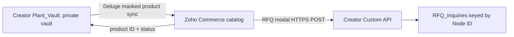

# JollyRx masked catalog prototype

**Creator-only:** Real Plant Name, Factory Address, Drug License (`License_No`), SMF upload (`Site_Master_File`), and Molecule. None may appear in product payloads, descriptions, SEO, images/alt text, URLs, public response or browser assets. Commerce catalog is exactly Masked Node ID, Dosage Form, Certification, MOQ; title `<Dosage Form> - <Node ID>`. Molecule remains private unless separately approved.

## RFQ endpoint choice
Use a Creator Custom API (POST, Entire JSON, Public Key authentication) with narrow Deluge validation. It is available on all Creator plans, with plan-dependent invocation limits. Public key is visible to every visitor, so validate inputs, use a honeypot, monitor/rate-limit, and return no internal data. For stronger production security use a server-side proxy with secrets held server-side. [Create/manage Custom APIs](https://help.zoho.com/portal/en/kb/creator/developer-guide/microservices/custom-api/articles/create-and-manage-custom-apis) · [API limits](https://www.zoho.com/creator/help/api/v2.1/api-limits.html)

Alternatives: OAuth2 Custom API requires authenticated callers, unsuitable for anonymous buyers. Published form permalink / Publish Add Records can accept public submissions but exposes a public link and offers less control of business validation/response. It is production-only and requires `privatelink`. [Published Add Records](https://www.zoho.com/creator/help/api/v2.1/publish-api/add-records.html) A standalone Deluge function is not itself an anonymous HTTP endpoint; expose it through a supported API wrapper.

**CORS is a gate:** test browser Network panel including OPTIONS from the published Commerce origin. If Creator does not allow the origin, use a same-origin/server proxy or an embedded published Creator RFQ form. `no-cors` cannot provide a readable success response; front-end headers cannot fix server CORS.

## Current official API references
- Commerce product endpoint family: `POST https://commerce.zoho.in/store/api/v1/products`, update `PUT .../products/{product_id}` for this India tenant. Use only `ZohoCommerce.items.CREATE` and `ZohoCommerce.items.UPDATE` scopes. The Create API requires `name`, `url`, and a `variants` array; the Deluge payload includes these fields, no delete access. [Create product](https://www.zoho.com/commerce/api/create-a-product-with-variant.html) · [Update product](https://www.zoho.com/commerce/api/update-a-product.html)
- Commerce domain: US `.com`, EU `.eu`, India `.in`, AU `.com.au`, Japan `.jp`; use signed-in Commerce domain. [Multiple DCs](https://www.zoho.com/commerce/api/multiple-data-centers.html)
- Creator authenticated add: `POST https://<base_url>/creator/v2.1/data/<owner>/<app_link_name>/form/<form_link_name>`, scope `ZohoCreator.form.CREATE`; DC-specific `zohoapis` host. [Add records](https://www.zoho.com/creator/help/api/v2.1/add-records.html) · [OAuth/scopes](https://www.zoho.com/creator/help/api/v2.1/oauth-overview.html)
- Published Creator add: `POST https://<base_url>/creator/v2.1/publish/<owner>/<app_link_name>/form/<form_link_name>?privatelink=...`; production-only; no OAuth scope documented for this public link flow.
- Copy generated Custom API URL from Creator; do not guess it. Account region determines host.

## What needs Zoho UI
[UI-ONLY] Create app/forms, upload three dummy SMFs, create OAuth connection + Custom API, create/publish Commerce store and obtain actual preview URL. [CODE] Files provide setup and code starters. Verify actual Commerce theme selectors and CORS before publish. No live URL or recording is invented.
